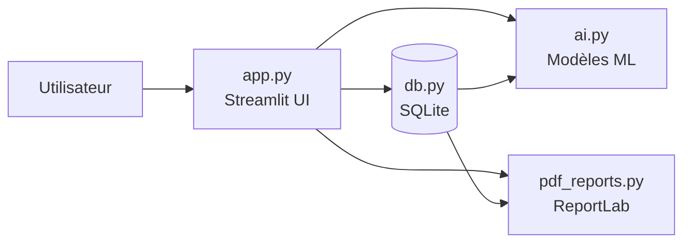

<div align="center">

# RC Gestion
### *Quand la comptabilité marocaine rencontre l'intelligence artificielle*

**La plateforme qui gère vos clients, vos déclarations, votre paie…<br>et qui devine qui va être en retard avant même que ça arrive.**

<br>


*Projet de Stage Technique · EST El Kelaa des Sraghna · Université Cadi Ayyad · 2025–2026*

</div>

---

## L'histoire derrière le projet

Dans un bureau comptable, tout se joue sur les **dates limites** : TVA, IS, IR, CNSS, Patente… Un oubli, et c'est la pénalité.

Pendant mon stage chez **RC Gestion** (El Kelaa des Sraghna), spécialisé dans la création d'entreprises, la comptabilité et les déclarations fiscales, j'ai voulu répondre à une question simple :

> **« Et si l'application pouvait prévenir les retards au lieu de les constater ? »**

Le résultat : une application web complète qui centralise tout le travail du cabinet, avec un **cerveau ML** intégré qui prédit, prévoit et détecte.

---

## Ce que fait RC Gestion

| Module | En bref |
|--------|---------|
| **Clients** | Personnes Physiques & Morales, fiche complète (CIN, RC, IF, Patente, ICE, régime fiscal), filtres et recherche en temps réel |
| **Déclarations fiscales** | TVA, IS, IR, CNSS, Patente, avec statuts *Déposée / En attente / En retard* et export Excel & PDF |
| **Comptabilité** | Journal des opérations, bilan simplifié automatique, calcul TVA (HT → TVA → TTC) |
| **Paie** | Simulateur de salaire (CNSS, AMO, IR selon le barème marocain 2024) et bulletins PDF |
| **Création d'entreprise** | Suivi pas à pas : Statuts → RC → IF → Patente → ICE → CNSS → Banque |
| **Intelligence artificielle** | Risque de retard, prévision du CA, détection d'anomalies |
| **Rapports** | Rapport général du cabinet, fiches clients PDF, export Excel multi-feuilles |

<details>
<summary><b>Gestion des clients : détails</b></summary>

- Personnes Physiques (PP) et Personnes Morales (PM)
- Fiche : CIN / RC / IF / Patente / ICE / secteur / régime fiscal
- Filtres avancés, export Excel, recherche instantanée
</details>

<details>
<summary><b>Déclarations fiscales : détails</b></summary>

- Suivi TVA, IS, IR, CNSS, Patente
- Historique par client avec statuts
- Mise à jour rapide des statuts et des montants payés
- Export Excel & PDF
</details>

<details>
<summary><b>Paie : détails</b></summary>

- CNSS salariale & patronale
- AMO salariale & patronale
- IR mensuel (barème marocain 2024)
- Bulletins de paie PDF téléchargeables + historique par employé
</details>

---

## Le cerveau de la plateforme

Trois modèles, trois super-pouvoirs :

| Modèle | Mission |
|-----------|-----------|
| **Random Forest** | *« Ce client va-t-il être en retard ? »* → probabilité de retard fiscal |
| **Régression Linéaire** | *« Combien va-t-il facturer le mois prochain ? »* → prévision du CA |
| **Isolation Forest** | *« Ce montant est-il louche ? »* → détection d'anomalies |

### Prédiction de retard : Random Forest
Apprend de l'historique de toutes les déclarations du cabinet et estime la probabilité qu'un client soit en retard.

```
Entrées  : type_déclaration · secteur_activité · mode_déclaration · type_personne · montant
Sortie   : probabilité de retard (0% → 100%) + niveau Faible / Modéré / Élevé
```

### Prévision du CA : Régression Linéaire
Analyse les factures de vente d'un client et projette son chiffre d'affaires du mois suivant.

```
Entrées  : historique des factures de vente (minimum 3 mois)
Sortie   : CA prévisionnel en MAD + graphique de tendance
```

### Détection d'anomalies : Isolation Forest
Repère les déclarations dont les montants s'écartent statistiquement de l'historique du cabinet.

```
Entrées  : montant_dû · montant_payé de toutes les déclarations
Sortie   : liste des déclarations suspectes avec client et type
```

---

## Architecture



### Stack technique

```
Backend & Data    →  Python 3.11 · SQLite · Pandas · NumPy
Machine Learning  →  Scikit-learn (RandomForest · LinearRegression · IsolationForest)
Interface Web     →  Streamlit · Plotly Express · Plotly Graph Objects
Exports           →  ReportLab (PDF) · OpenPyXL (Excel)
Base de données   →  SQLite3 (locale, zéro serveur)
```

### Structure du projet

```
RC_Gestion_/
│
├── app.py            # Application principale Streamlit (UI + navigation)
├── db.py             # Couche données SQLite (CRUD + données de démo)
├── ai.py             # Module IA (Random Forest, Régression, Isolation Forest)
├── pdf_reports.py    # Génération des rapports PDF (ReportLab)
│
├── requirements.txt  # Dépendances Python
├── .gitignore        # Fichiers exclus du versioning
├── LICENSE           # Licence MIT
└── README.md         # Vous êtes ici.
```

---

## Démarrage en 4 commandes

```bash
# 1⃣ Cloner le projet
git clone https://github.com/Chaymae-El-Bahloul/rc-gestion.git
cd rc-gestion

# 2⃣ Créer un environnement virtuel (recommandé)
python -m venv venv
venv\Scripts\activate          # Windows
# source venv/bin/activate     # macOS / Linux

# 3⃣ Installer les dépendances
pip install -r requirements.txt

# 4⃣ Lancer l'application
streamlit run app.py
```

L'application s'ouvre sur **http://localhost:8501**

---

## Comptes de démonstration

| Rôle | Identifiant | Mot de passe | Accès |
|---------|----------------|-----------------|----------|
| Administrateur | `admin` | `admin123` | Toutes les fonctionnalités |
| Comptable | `comptable` | `compta456` | Déclarations, comptabilité, paie |
| Client | `client` | `client789` | Consultation de son dossier |

> Comptes de **démonstration uniquement**. À remplacer avant tout usage réel.

---

## Dépendances

```txt
streamlit
pandas
numpy
scikit-learn
plotly
reportlab
openpyxl
```

---

## Contribuer

Les idées et suggestions sont les bienvenues ! Ouvrez une *issue* ou proposez une *pull request* : fork → branche → commit → PR.

---

## Licence

Ce projet est distribué sous licence **MIT**. Vous pouvez l'utiliser, le modifier et le redistribuer librement, à condition de conserver la mention de copyright. Voir le fichier [LICENSE](LICENSE) pour le texte complet.

---

<div align="center">

## Auteure

**Chaymae EL BAHLOUL**<br>
Étudiante en 2ème année Ingénierie des Données<br>
École Supérieure de Technologie (EST) El Kelaa des Sraghna · Université Cadi Ayyad, Marrakech

*Stage réalisé chez **RC Gestion**, Bureau de Conseil et Gestion d'Entreprises, El Kelaa des Sraghna*

[](https://github.com/Chaymae-El-Bahloul)

<br>

*Si ce projet vous plaît, laissez une étoile, ça fait toujours plaisir !*

</div>
